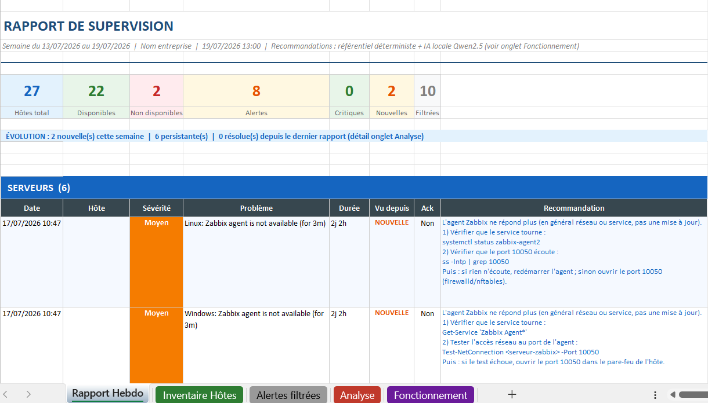
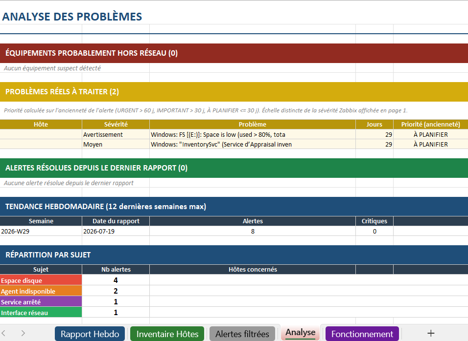
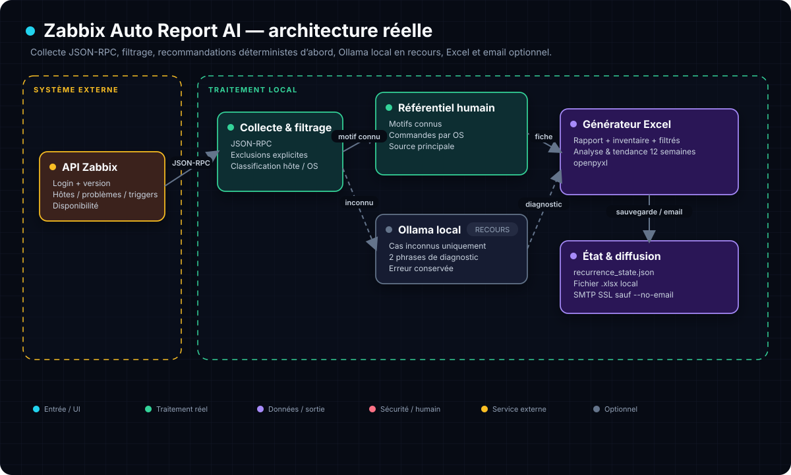

# 📊 Zabbix Auto Report
[](https://github.com/Yukouf/zabbix-auto-report-ai/actions/workflows/security-scan.yml)

<p align="center">
  <a href="README.md">English</a> &bull;
  <a href="README_fr.md">Français</a>
</p>

> Weekly monitoring report in Excel, generated automatically from Zabbix, with ready-to-use diagnostic recommendations, and no data leaving the server.


-6A1B9A)


---

## 🎯 The problem solved

Zabbix monitors very well, but **nobody reads a monitoring interface on Monday morning**. IT teams and managers want a simple answer to three questions:

1. What is broken this week?
2. Is it new, or has it been dragging on for a month?
3. What concrete action is taken for each problem?

This script answers all three, in an Excel file sent by email every week, readable by both a technician and a non-technical manager.

---

## 👀 Overview

| Page 1, Weekly Report | Analysis Tab |
|---|---|
|  |  |

*(Screenshots from demonstration data.)*

---

## ✨ What the report contains

The generated Excel file contains **5 tabs**:

| Tab | Content |
|---|---|
| **Weekly Report** | Key indicators (hosts, availability, alerts, critical, new), a trend line versus the previous report, then alerts sorted by category (servers, network, workstations, peripherals) with severity, age, acknowledgement and **diagnostic recommendation** |
| **Host Inventory** | All monitored hosts: IP, groups, state, availability, type |
| **Filtered alerts** | The noise excluded from the report (and why), for transparency |
| **Analysis** | Devices probably offline, real problems prioritized by age, **alerts resolved since the last report**, **12-week trend**, distribution by topic |
| **How it works** | Explanation in simple French, aimed at non-technicians, of how the recommendations are produced |

### 🔎 Recurrence tracking

Each alert is tracked week after week through a local state file:

- **NEW** (in orange): first appearance this week
- **“5 wks”**: the alert has been recurring for 5 consecutive reports, it is dragging on
- **Resolved**: present last week, gone since (listed in the Analysis tab)

This is what turns a plain list of alerts into a real management tool: it shows whether the situation is improving or worsening.

---

## 🧠 How the recommendations are produced

This is the heart of the project, and its architecture is deliberately **deterministic first, AI second**:



The script retrieves hosts, availabilities, problems and triggers via JSON-RPC. After filtering, each alert first goes through the human reference base; the local Ollama instance only intervenes when no known pattern matches. The workbook and the recurrence state are written locally, then the SMTP sending can be disabled with `--no-email`.

### 1. The deterministic reference base (main source)

A library of response sheets **written by hand and validated**: disk full, service stopped, agent unreachable, machine rebooted, memory/CPU pressure, clock out of sync, network port down, printer consumable...

For each alert, the script:
1. detects the pattern by keywords in the label,
2. identifies the system concerned (Windows / Linux / switch) to give the right commands,
3. fills the sheet with the real values of the alert (service name, disk letter, port number).

Same alert = always the same recommendation. Zero improvisation.

### 2. The local AI (only for unknown cases)

If no sheet matches, the script queries a model **hosted on the server itself via Ollama** (Qwen2.5 by default). Key points:

- 🔒 **No data leaves the infrastructure**, no cloud API, GDPR compliant
- 🎯 The OS is **imposed** on the AI by the script (no more Linux commands suggested on a Windows server)
- 🛡️ Strict instructions: 2 sentences max, diagnosis only, never a destructive command
- 🧹 The answer is cleaned (markdown removed, length bounded) before insertion

On each run, the script displays the breakdown: `12 via deterministic reference base, 1 via local AI`. The more the reference base grows, the less the AI is involved.

---

## 🚀 Installation

### Prerequisites

- Python 3.8+
- A Zabbix server 6.0 to 7.x with an API user (read-only is enough)
- Optional: [Ollama](https://ollama.com) installed locally for the AI recommendations (`ollama pull qwen2.5:7b`)
- Optional: an SMTP account for automatic sending by email

### Steps

```bash
# 1. Clone the repository
git clone https://github.com/Yukouf/zabbix-auto-report-ai.git
cd zabbix-auto-report-ai

# 2. Install the dependency (only one!)
pip install openpyxl

# 3. Create the configuration
cp .env.example .env
nano .env        # fill in the Zabbix URL, credentials, recipients...

# 4. First test without sending email
python3 zabbix_auto_report.py --no-email
```

The report `rapport_zabbix_YYYY-MM-DD.xlsx` is created in the configured folder.

### Automatic sending every week (cron)

```bash
crontab -e
# Every Monday at 8:00:
0 8 * * 1 /usr/bin/python3 /chemin/vers/zabbix_auto_report.py
```

---

## ⚙️ Configuration

Everything is configured in the `.env` file (never in the code):

| Variable | Role | Example |
|---|---|---|
| `ZABBIX_URL` | Zabbix API URL | `https://zabbix.mydomain.local/api_jsonrpc.php` |
| `ZABBIX_USER` / `ZABBIX_PASS` | API user (read-only) | `rapport-auto` |
| `VERIFY_SSL` | `true` if the certificate is valid, `false` if self-signed | `false` |
| `SMTP_SERVER` / `SMTP_PORT` | Sending server (SSL) | `smtp.mydomain.com` / `465` |
| `SMTP_USER` / `SMTP_PASS` | SMTP account | |
| `SMTP_FROM` / `SMTP_SENDER` | Displayed sender / sending address | |
| `EMAIL_TO` | Recipients, separated by commas | `it@acme.com,manager@acme.com` |
| `COMPANY_NAME` | Name displayed in the report header | `ACME Corp` |
| `REPORT_DIR` | Output folder for the reports | `/opt/rapports` |
| `OLLAMA_URL` / `OLLAMA_MODEL` | Local AI (optional) | `http://127.0.0.1:11434/api/generate` / `qwen2.5:7b` |
| `NETWORK_KEYWORDS` | Keywords identifying the switches (host names) | `aruba,cisco,switch` |
| `EXCLUDED_PATTERNS` | Alert patterns to filter, separated by `;` | |

💡 **Without Ollama, the script still works**: the reference base covers the common alerts, and unknown cases will simply display an AI error in the recommendation column.

---

## 🧩 Adapting the reference base to the IT fleet

The response sheets are in the `COMMAND_TABLE` variable of the script. Each sheet = detection keywords + one answer per OS type:

```python
{   # Example: expired certificate
    "patterns": ["certificate", "cert expires"],
    "commands": {
        "Linux": "Le certificat arrive à expiration.\n1) Vérifier la date :\nopenssl x509 -enddate -noout -in <chemin>\nPuis : renouveler avant l'échéance.",
    },
},
```

Custom sheets can be added as alerts are encountered: this is how the report becomes more and more autonomous.

---

## 🔐 Security and confidentiality

- **No credentials in the code**: everything goes through `.env` (ignored by git)
- A **read-only Zabbix user** is recommended
- **100% local AI**: alert labels (which contain internal host names) are never sent to a third-party service
- The state file `recurrence_state.json` and the generated reports are excluded from the repository

---

## 🛠️ Technical choices

| Choice | Why |
|---|---|
| Python standard library + openpyxl only | Trivial deployment on a production server, no dependency chain to audit |
| Reference base before AI | Reliability and reproducibility first; the AI is a safety net, not a driver |
| API 6.0 → 7.x compatibility | Automatic version detection (`selectGroups` vs `selectHostGroups`) |
| Local JSON state file | Recurrence tracking without a database |
| Counter by ISO week | Running the script several times in the week does not distort the statistics |

---

## 👤 Author

**Youssef Guerniou**, [github.com/Yukouf](https://github.com/Yukouf)

Project developed as part of a SOC/monitoring deployment in production. See also: [Wazuh-CVE-Alerter](https://github.com/Yukouf/wazuh-cve-alerter-mail).

## 📄 License

MIT, free to use, including in a company.
